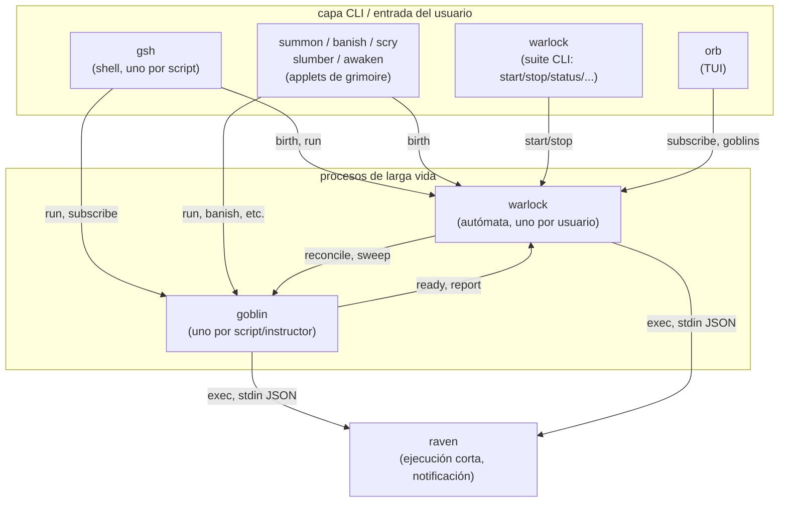
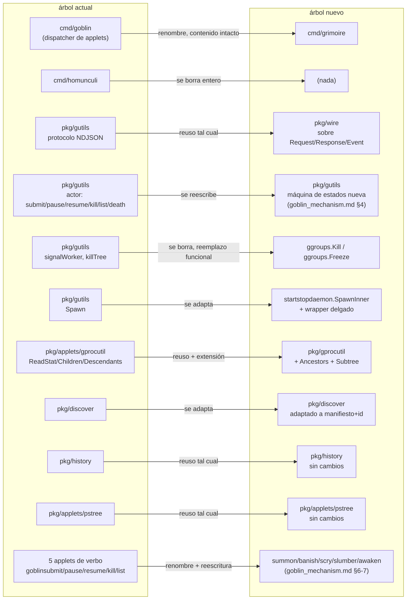
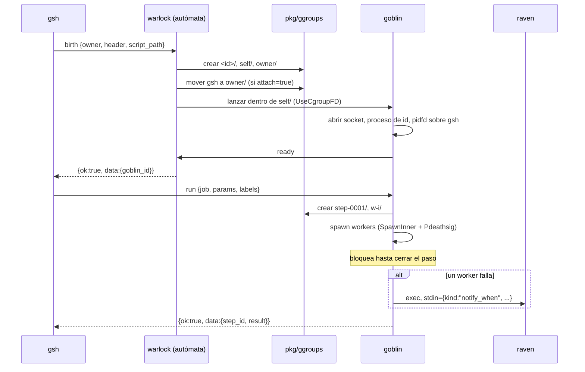
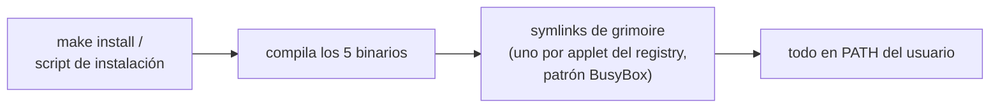

# structure — binarios, paquetes y migración (v1)

Complementa a los cinco documentos anteriores (`ggroups-spec.md`, `goblin_mechanism.md`,
`wire-spec.md`, `orb-spec.md`, `warlock-spec.md`). Este cubre lo que no es diseño de
comportamiento sino organización del repo: qué binarios existen, qué paquetes los sostienen,
qué se reusa del árbol actual y qué se borra.

Los diagramas usan bloques ```mermaid```, que Obsidian renderiza de forma nativa sin
plugins adicionales.

## 0. Cómo leer este documento

| Marca | Significado |
|---|---|
| **[DECIDIDO]** | Acordado explícitamente en la sesión. |
| **[ASUMIDO]** | Agregado para completar el diseño. **Revisar primero estas.** |
| **[ABIERTO]** | Sin decidir. |

---

## 1. Los seis binarios

**[DECIDIDO]**



| Binario | Rol | Documento de referencia |
|---|---|---|
| `grimoire` | multi-call de applets heredados del fork + `summon`/`banish`/`scry`/`slumber`/`awaken` | `goblin_mechanism.md` §6-7 |
| `goblin` | proceso por script/instructor; padre de los workers | `ggroups-spec.md`, `goblin_mechanism.md` |
| `warlock` | autómata (uno por usuario) + suite CLI | `warlock-spec.md` |
| `orb` | TUI, cliente puro de `warlock` | `orb-spec.md` |
| `raven` | protocolo de notificación, ejecución corta | `wire-spec.md` §8 |
| `gsh`/`gash` | shell y su extensión; instructor por defecto | sesión de `gash` (externa) |

---

## 2. Paquetes propuestos

**[ASUMIDO]** (nombres tentativos, no hay código todavía que los contradiga)

```
cmd/
├── grimoire/     → multi-call: applets heredados + summon/banish/scry/slumber/awaken
├── goblin/       → el proceso por script (NUEVO; no es el dispatcher viejo)
├── warlock/      → autómata + suite CLI
├── orb/          → TUI
└── raven/        → protocolo de notificación

pkg/
├── ggroups/      → cgroups v2 (ggroups-spec.md §12)
├── gutils/       → protocolo NDJSON + actor del goblin
├── gprocutil/    → árbol de procesos (+ Ancestors/Subtree nuevos)
├── discover/     → resolución de goblins por placa/manifiesto
├── history/      → historial append-only
├── wire/         → structs del sobre + ambas APIs (wire-spec.md §3)
└── applets/      → árbol heredado y podado del fork (kill, pgrep, ps, ash, ...)
```

**[DECIDIDO]** El repo tiene 0 commits todavía (dato del handoff original) — no hay
historial de git que proteger, así que el rename de `cmd/goblin` (dispatcher viejo) a
`cmd/grimoire`, con un `cmd/goblin` nuevo de contenido distinto en el mismo cambio, se hace
limpio, sin rodeos para preservar `git blame`.

---

## 3. Nombre del módulo Go

**[DECIDIDO]** Se mantiene `goblin` como nombre del módulo, aunque coincida con el nombre
de uno de los seis binarios — mismo patrón que `docker/docker` en el ecosistema Go. Cambiar
el módulo ahora tocaría cada import del árbol por una razón puramente estética, sin
beneficio funcional.

---

## 4. Migración: qué pasa con cada pieza existente

**[DECIDIDO]**



| Pieza actual | Destino | Motivo |
|---|---|---|
| `cmd/goblin` (dispatcher) | renombrado a `cmd/grimoire`, intacto | libera el nombre `goblin` para el proceso nuevo |
| `homunculi` (binario y todo su directorio) | **borrado entero** | su rol se repartió entre `goblin` (padre real, `Wait()`) y `warlock` (guardián, estado) |
| `pkg/gutils` protocolo NDJSON (`Event`, `Call`, `SimpleVerb`, `Serve`) | **reuso tal cual** | es la forma de sobre que `wire-spec.md` terminó formalizando |
| `pkg/gutils` actor (6 verbos: submit/pause/resume/kill/list/death) | **reescrito** | la máquina de estados de `goblin_mechanism.md` §4 (pasos, reglas, hooks) es mucho más rica |
| `pkg/gutils` `signalWorker`/`killTree` | **borrado** | reemplazado por `cgroup.kill`/`cgroup.freeze` |
| `pkg/gutils` `Spawn` | **adaptado** | pasa a ser wrapper delgado sobre `startstopdaemon.SpawnInner` (`goblin_mechanism.md` §10.2) |
| `pkg/applets/gprocutil` | **reuso + extensión** | se agregan `Ancestors`/`Subtree` sobre la misma base (`ReadStat`) |
| `pkg/discover` | **adaptado** | la convención por PPID se reemplaza por manifiesto+id; se conserva la lógica de "confirmar vivo, borrar huérfanos" |
| `pkg/history` | **reuso tal cual** | el patrón append + `Compact` (temp-file + rename) ya sirve para `<id>.history.jsonl` y `pending.jsonl` |
| `pkg/applets/pstree` | **reuso tal cual** | ya consume `gprocutil` sin depender de `gutils` |
| 5 applets de verbo (`goblinsubmit`/...) | **renombrados y reescritos** | pasan a `summon`/`banish`/`scry`/`slumber`/`awaken`, con direccionamiento nuevo (`goblin_mechanism.md` §6) |

**Nuevo, sin equivalente en el árbol actual:** `pkg/ggroups`, `cmd/orb`, `cmd/raven`,
`pkg/wire` (como paquete propio, aunque reusa el formato de `gutils`), `startstopdaemon.SpawnInner`.

---

## 5. Flujo de nacimiento, para verificar que la estructura cierra

**[ASUMIDO]** Diagrama de secuencia del caso más común (`gsh` corre un `.gsh`, primer
`run`), cruzando los cinco documentos, como prueba de que los binarios propuestos alcanzan
para el flujo completo:



---

## 6. Fixes chicos del handoff original

**[DECIDIDO]**

- **#9** (`listSummary` imprime el PID como carácter Unicode en vez de decimal): **no
  aplica más**. Ese código vivía en el actor viejo de `pkg/gutils`, que se reescribe
  entero (§4). Se resuelve por omisión, al no portar el bug.
- **#10** (bug de aislamiento de entorno en `testutil.go:200`, suite de `ash`): **sin
  relación** con este diseño — pertenece al árbol heredado de `ash`, intacto. Queda como
  pendiente aparte; candidata natural para resolverse en la sesión de `gash`, que ya toca
  ese árbol directamente.

---

## 7. Instalación

**[DECIDIDO]** Deliberadamente mínima, sin depender de `systemd` — coherente con que
`warlock-spec.md` §3 ya hace que el arranque sea autosuficiente (el primer cliente que
necesita a `warlock` lo despierta).



**[ASUMIDO]** No hay unidad de systemd de usuario, ni auto-arranque al login. El mecanismo
de `warlock-spec.md` §3 (watchdog + `flock` como red de última instancia) ya cubre el caso
de "nada está corriendo todavía".

---

## 8. Pendientes

**Abiertos:** ninguno nuevo — este documento organiza decisiones ya cerradas en los cinco
anteriores, no introduce preguntas de diseño propias.

**Por hacer, no por decidir:** la migración en sí (mover/renombrar/borrar código real) queda
pendiente de ejecución, no de diseño.
